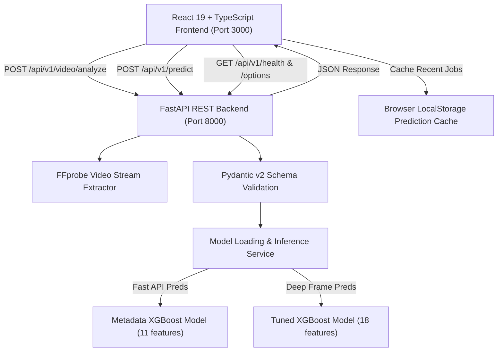

# VidOpt AI – Intelligent Video Transcoding Time Prediction

[](https://www.python.org/)
[](https://fastapi.tiangolo.com/)
[](https://react.dev/)
[](https://www.typescriptlang.org/)
[](https://tailwindcss.com/)
[](https://xgboost.readthedocs.io/)
[](https://opensource.org/licenses/MIT)

> **VidOpt AI** is a production-grade machine learning system and full-stack analytics platform that forecasts video transcoding duration (`utime`) prior to encoding, enabling intelligent compute cluster scheduling, queue optimization, and cost savings.

---

## 📑 Table of Contents

1. [Problem Statement & Solution](#-problem-statement--solution)
2. [System Architecture](#-system-architecture)
3. [Machine Learning Methodology](#-machine-learning-methodology)
4. [Empirical Model Comparison](#-empirical-model-comparison)
5. [Production Models](#-production-models)
6. [Technology Stack](#-technology-stack)
7. [API Endpoints Reference](#-api-endpoints-reference)
8. [Frontend Features](#-frontend-features)
9. [Project Structure](#-project-structure)
10. [Local Quickstart Guide](#-local-quickstart-guide)
11. [Testing & Verification](#-testing--verification)
12. [Scientific & Hardware Limitations](#-scientific--hardware-limitations)
13. [Dataset Attribution](#-dataset-attribution)
14. [License](#-license)

---

## 🎯 Problem Statement & Solution

### The Challenge
Video transcoding is computationally heavy and non-linear. Processing duration depends on video length, source codecs, compression complexity, target resolutions, and bitrates. Cloud media processing pipelines without duration estimates suffer from:
- Inefficient spot-instance scheduling.
- Worker queue starvation and worker bottlenecking.
- Inability to provide users with accurate processing wait estimates.

### The VidOpt AI Solution
VidOpt AI trains gradient-boosted regression trees on **68,784 real-world transcoding measurements** across **1,099 unique videos**. It delivers:
- **Tuned XGBoost Regressor (Full Model):** Achieves **1.60 s MAE** ($R^2 = 0.9356$) when frame-level inspection is available.
- **Metadata-Only Regressor (API Model):** Achieves **1.80 s MAE** ($R^2 = 0.9213$) using only 11 container metadata attributes with **zero decoding overhead**.

---

## 🏛 System Architecture



---

## 🔬 Machine Learning Methodology

### Data Preprocessing & Leakage Prevention
1. **Dataset Dimensions:** 68,784 records, 22 columns, 1,099 unique video IDs.
2. **Video-Level Group Splitting:** To avoid data leakage across different encodings of the same source video clip, all cross-validation and testing use strict `GroupShuffleSplit` and `GroupKFold` on the video `id`.
   - **Training Set:** 50,439 samples (879 unique video IDs).
   - **Testing Set:** 18,345 samples (220 unique video IDs).
   - **Leakage Check:** 0 shared video IDs between train and test splits (`assert set(train).isdisjoint(test)`).
3. **Hyperparameter Tuning:** 5-fold cross-validation with `RandomizedSearchCV(n_iter=20, scoring="neg_mean_absolute_error")`.

---

## 📊 Empirical Model Comparison

All models were evaluated on the identical held-out test split of 18,345 records:

| Model Architecture | MAE (s) | RMSE (s) | $R^2$ Score | Latency (1k preds) | Model File Size |
|---|---:|---:|---:|---:|---:|
| Random Forest Baseline | 1.7438 s | 4.5048 s | 0.9177 | 85,410 ms | 863.6 MB |
| Tuned Random Forest | 1.6212 s | 4.3490 s | 0.9233 | 109,528 ms | 524.9 MB |
| XGBoost Baseline | 1.8307 s | 4.0727 s | 0.9327 | 13,034 ms | 2.5 MB |
| **Tuned XGBoost (Selected Final)** | **1.6048 s** | **3.9863 s** | **0.9356** | **12,195 ms** | **6.0 MB** |
| *Metadata-Only XGBoost* | *1.7978 s* | *4.4050 s* | *0.9213* | *11,450 ms* | *4.2 MB* |

> **Note on $R^2$:** $R^2$ measures the proportion of target variance explained by the model (here, 93.56%), not a simple classification accuracy percentage.

---

## 🏆 Production Models

### 1. Tuned XGBoost (`models/final_model.pkl`)
- **Parameters:** `n_estimators=500`, `max_depth=8`, `learning_rate=0.03`, `subsample=0.9`, `colsample_bytree=0.8`, `reg_lambda=1.5`, `min_child_weight=1`, `gamma=0`.
- **Inputs (18 features):** `duration`, `width`, `height`, `bitrate`, `framerate`, `i`, `p`, `b`, `frames`, `i_size`, `p_size`, `size`, `o_bitrate`, `o_framerate`, `o_width`, `o_height`, `codec`, `o_codec`.
- **Primary Strength:** Lowest absolute error and lowest outlier sensitivity on complex high-definition streams.

### 2. Metadata-Only Model (`models/metadata_transcoding_model.pkl`)
- **Inputs (11 features):** `duration`, `width`, `height`, `bitrate`, `framerate`, `o_bitrate`, `o_framerate`, `o_width`, `o_height`, `codec`, `o_codec`.
- **Primary Strength:** Excludes all frame-level decoding features (`i`, `p`, `b`, `frames`, `i_size`, `p_size`, `size`), allowing instant predictions directly from container headers.

---

## 💻 Technology Stack

- **Backend:** Python 3.11, FastAPI, Uvicorn, Pydantic v2, Scikit-learn, XGBoost, Joblib, Pytest.
- **Frontend:** React 19, TypeScript, Vite, Tailwind CSS v4, Lucide React, Recharts, Axios, Vitest.
- **Media Tools:** FFmpeg & FFprobe (optional for video upload analysis).
- **Version Control:** Git & Git LFS.

---

## 🔌 API Endpoints Reference

Base URL: `http://127.0.0.1:8000/api/v1`

| Method | Endpoint | Description |
|---|---|---|
| `GET` | `/health` | API and model status, FFprobe detection |
| `GET` | `/model/info` | Public feature metadata, limitations |
| `GET` | `/options` | Allowed codecs, upload limits, extensions |
| `POST` | `/predict` | Metadata-only transcoding duration estimation |
| `POST` | `/predict/full` | Full 18-feature transcoding estimation |
| `POST` | `/transcoding/configure` | Configuration validation and consistency check |
| `POST` | `/video/analyze` | Video upload and FFprobe metadata extraction |

Interactive Swagger documentation is available at **`http://127.0.0.1:8000/docs`**.

---

## 🎨 Frontend Features

1. **Dashboard:** KPI summary, real-time backend status pill, interactive Recharts model comparison, and quick-start actions.
2. **Analyze Video Page:**
   - Drag-and-drop video upload with format and size validation.
   - Graceful fallback with 1-click benchmark presets (1080p, 720p, 4K, 480p) when FFprobe is not installed in server PATH.
   - Target configuration panel with resolution, bitrate, and codec presets.
   - Direct connection to live ML prediction API.
3. **Prediction Result Display:**
   - Estimated transcoding time with formatted readout.
   - Realtime factor comparison ($T_{transcode} / T_{duration}$).
   - Job summary and confidence bounds notice.
4. **Prediction History:** Local browser persistence (localStorage) with search, filter, item deletion, and clear actions.
5. **Model Insights:** Empirical matrix, interactive metric visualization (MAE vs RMSE vs $R^2$), feature importance ranking, and resolution error breakdown.
6. **About Page:** Technical mission, architecture flow diagram, and dataset attribution.

---

## 📂 Project Structure

```text
video_transcoding/
├── backend/
│   ├── app/
│   │   ├── api/routes.py             # REST endpoints
│   │   ├── schemas/prediction.py     # Pydantic validation schemas
│   │   ├── services/
│   │   │   ├── model_service.py      # Model loader singleton
│   │   │   ├── prediction_service.py # Inference and time formatting
│   │   │   └── video_service.py      # FFprobe subprocess extractor
│   │   ├── utils/validators.py       # Validation helpers
│   │   ├── config.py                 # Paths and constants
│   │   └── main.py                   # FastAPI lifespan application
│   ├── tests/
│   │   ├── test_e2e_integration.py   # Live model integration tests
│   │   ├── test_health.py            # Health check tests
│   │   ├── test_prediction.py        # Input validation tests
│   │   └── test_video_metadata.py    # FFprobe mocking & error tests
│   ├── README.md
│   └── requirements.txt
├── frontend/
│   ├── src/
│   │   ├── components/               # Layout, Header, Sidebar, MetricCard
│   │   ├── pages/                    # Dashboard, Analyze, History, Insights, About
│   │   ├── services/api.ts           # Axios API client
│   │   ├── types/index.ts            # TypeScript interfaces
│   │   ├── utils/history.ts          # LocalStorage CRUD
│   │   ├── tests/                    # Vitest unit tests
│   │   ├── App.tsx                   # Main routes
│   │   └── main.tsx
│   ├── package.json
│   ├── tsconfig.json
│   └── vite.config.ts
├── dataset/
│   ├── README.txt
│   ├── transcoding_mesurment.tsv     # Primary dataset (68,784 rows)
│   └── youtube_videos.tsv
├── models/
│   ├── final_model.pkl               # Selected Tuned XGBoost
│   ├── metadata_transcoding_model.pkl# Zero-decode XGBoost
│   ├── tuned_xgboost_model.pkl
│   ├── tuned_random_forest_model.pkl
│   └── random_forest_model.pkl
├── results/
│   ├── plots/                        # Generated evaluation charts
│   ├── model_comparison.csv
│   ├── error_analysis.csv
│   └── tuned_xgboost_best_params.csv
├── compare_models.py
├── error_analysis.py
├── metadata_model.py
├── ml_utils.py
├── ml_verification.py
├── tune_xgboost.py
├── requirements.txt
└── .gitignore
```

---

## 🚀 Local Quickstart Guide

### 1. Prerequisites
- **Python 3.11+**
- **Node.js 18+ & npm 9+**
- *(Optional)* **FFmpeg/FFprobe** for video file upload analysis.
  ```powershell
  winget install Gyan.FFmpeg
  ```

### 2. Backend Setup
```powershell
# Navigate to backend directory
cd C:\Users\thott\Desktop\video_transcoding\backend

# Create and activate virtual environment
python -m venv .venv
.venv\Scripts\Activate.ps1

# Install backend dependencies
pip install -r requirements.txt

# Start the FastAPI server
uvicorn app.main:app --host 127.0.0.1 --port 8000 --reload
```
Backend will be live at `http://127.0.0.1:8000`.

### 3. Frontend Setup
```powershell
# Open a second terminal and navigate to frontend
cd C:\Users\thott\Desktop\video_transcoding\frontend

# Install dependencies
npm install

# Start the Vite development server
npm run dev
```
Frontend will be live at `http://localhost:3000`.

---

## ✅ Testing & Verification

The project includes automated verification across all layers:

### 1. Machine Learning Verification (10 Tests)
```powershell
python ml_verification.py
```
*Result:* **10 passed, 0 failed** (verifies model loads, non-negative bounds, 18-feature full pipeline, 11-feature metadata pipeline, and zero group leakage).

### 2. Backend Pytest Suite (28 Tests)
```powershell
cd backend
python -m pytest tests/ -v
```
*Result:* **28 passed, 0 failed** (verifies health, live metadata prediction, live full prediction, input rejections, 422 schemas, FFprobe timeouts, and mock error handling).

### 3. Frontend Unit Tests (8 Tests)
```powershell
cd frontend
npm test
```
*Result:* **8 passed, 0 failed** (verifies history CRUD, formatting helpers, and MetricCard rendering in jsdom).

### 4. Frontend Production Build
```powershell
cd frontend
npm run build
```
*Result:* **Built in 1.7s** with zero TypeScript errors.

---

## ⚠️ Scientific & Hardware Limitations

1. **Benchmark Reference Hardware:** Dataset ground-truth values were recorded with **FFmpeg 4 on an Intel Core i7-3720QM CPU**. Predictions reflect this standardized reference baseline.
2. **Hardware Acceleration:** Actual transcoding times on modern GPUs with dedicated hardware ASICs (NVIDIA NVENC, Intel QuickSync, Apple VideoToolbox) will execute faster than CPU software transcoding.
3. **Execution Scope:** VidOpt AI **predicts** transcoding time; it is not a video transcoding engine itself.

---

## 📚 Dataset Attribution

The model training data was obtained from the UCI Machine Learning Repository:
> **UCI Machine Learning Repository: Video Transcoding Dataset**  
> *Authors:* D. Deneke et al.  
> *URL:* [https://archive.ics.uci.edu/ml/datasets/video+transcoding+dataset](https://archive.ics.uci.edu/ml/datasets/video+transcoding+dataset)

---

## 📄 License

This project is licensed under the [MIT License](LICENSE).
